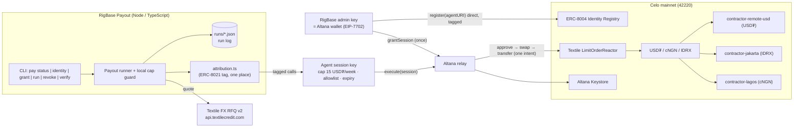

# RigBase Payout

**A contractor-payroll agent on Celo.** RigBase Studio pays its freelance contractors in their own local stablecoin. The agent converts USD₮ through **Textile FX** and pays from an **Altana** session wallet that the chain holds to a weekly cap, a contract allowlist and an expiry.

Built for Celo **Agents Open for Business**: Track 4 (Altana Agent Wallets) and Track 1 (Stablecoin Corridors / Textile FX).

---

## The problem

Small studios that hire contractors in Lagos or Jakarta pay them in one of two ways today. They use bank wires (slow, $25+ fees, bad FX), or they hand over USD stablecoins the contractor then has to off-ramp. Handing an AI agent the treasury key to automate this is a non-starter, because one bug or prompt injection can drain the wallet.

**RigBase Payout** lets the studio give the agent a *bounded* job: "pay this week's payroll, in each contractor's currency, and never spend more than 15 USD₮ a week". The bound is enforced on-chain by the wallet, not by the agent's own code.

**Who it's for:** small teams and DAOs paying a handful of cross-border contractors, who want automated, auditable payouts without giving an agent unlimited keys.

## What it does

1. The studio admin (the RigBase wallet) **grants a session key** to the payout agent through Altana: a weekly USD₮ cap, weekly caps on cNGN and IDRX, an allowlist of exactly which contracts and functions it may call, and a 14-day expiry. The key is registered in the Altana Keystore, so anyone can verify its authority.
2. The agent reads a **payroll file** (contractor, amount in USD₮, memo).
3. For each contractor paid in a local currency, it gets a **firm Textile RFQ v2 quote** (USD₮ → cNGN or IDRX). It then runs **one atomic intent**: approve → Textile swap → transfer the exact quoted amount to the contractor.
4. Contractors paid in USD₮ get a direct transfer through the same session.
5. Anything over the cap is **refused**: first by a local guard, and, when probed, by the session's on-chain policy (the relay's simulation fails). It is never broadcast.
6. Every run writes a **JSON run log**: quotes, the tagged calldata, the callsId, the tx hash, and a Celoscan link.

## Architecture



| Module | Responsibility |
| --- | --- |
| `src/attribution.ts` | The only place that builds a wallet client (`withAttribution`) or prepares relay calls (`tagCalls` + `assertCallsTagged`). Also scans a tx input for our tag. |
| `src/altana.ts` | Session permissions (cap, allowlist, expiry), `quoteGrantSession` / `grantSession`, session persistence (`serializeSession`, no secrets), `execute` as the session. |
| `src/textile.ts` | Textile RFQ v2: `preview`, a keyless firm `request` with an EIP-712 `TakerControl` proof, `submit`, `cancel`. |
| `src/identity.ts` | ERC-8004 registration (`agent/rigbase-payout.agent.json`). |
| `src/payout.ts` | Payroll → calls → quote/execute, the local cap guard, the over-cap probe. |
| `src/runlog.ts` | JSON run logs (`runs/live/` committed, `runs/dry/` ignored) and the rolling 7-day spend. |
| `src/keys.ts` | Loads keys from paths in env. Refuses any key file inside the repo. Never logs keys. |

## Tracks

| Track | How RigBase Payout meets it |
| --- | --- |
| **4: Altana Agent Wallets** | The agent spends only through an Altana session key with a weekly USD₮ cap, weekly local-currency caps, a contract + function allowlist, and an expiry. The key is registered in the Keystore (`register: true`). The over-cap payout is refused. `pay revoke` kills the key. |
| **1: Stablecoin Corridors (Textile FX)** | Real one-way corridors, USD₮ → cNGN (Nigeria) and USD₮ → IDRX (Indonesia), using Textile RFQ v2 firm quotes, settled on the Textile reactor and delivered to the contractor. No round-tripping, no wash volume. |

## Attribution tag (ERC-8021)

Loops issued the code `celo_f41eab517821`. We follow [celo-org/attribution-tags BUILDERS.md](https://github.com/celo-org/attribution-tags/blob/main/BUILDERS.md) and tag in one place, where clients are built:

- **Direct transactions** from the RigBase wallet (the ERC-8004 register, and any future direct tx) use `createWalletClient(...).extend(withAttribution(code))`. The suffix is at the end of calldata, so the standard `verifyTx` decodes it.
- **Altana relayed intents** (session payouts): the relay, not our wallet, broadcasts the outer transaction, and the SDK exposes no suffix hook. We therefore append the suffix to **every inner call's calldata** (`tagCalls`). `assertCallsTagged` refuses to send any call without it. The EVM ignores the trailing bytes, so the token, reactor and allowlist checks are unaffected. The tag lands on-chain inside the Orchestrator calldata. `pay verify <hash>` finds it by scanning for the ERC-8021 marker.
- **Textile swaps**: we call keyless, so Textile adds no tag of its own, and ours is the only one on `transactions.swap.data`.
- The code is checked at startup against the Loops-issued value. A mismatch refuses to run.

**Known limitation (open with Altana and Celo):** a relayed tx's *outer* calldata does not end with our suffix, and Altana's `grantSession` builds its own calls, which we cannot tag without patching the SDK. Indexers that only read the tail of `tx.input` (or only decode ERC-4337 `handleOps`) may therefore not credit relayed txs. See [Open questions](#open-questions).

## ERC-8004 identity

- The registry on Celo is `0x8004A169FB4a3325136EB29fA0ceB6D2e539a432`.
- `pay identity --live` calls `register(agentURI, [createdWith=altana])` **directly from the RigBase wallet, tagged**. `agentURI` points to [`agent/rigbase-payout.agent.json`](agent/rigbase-payout.agent.json) in this repo. The minted `agentId` is written back into that file.
- The Altana SDK would otherwise auto-register an *untagged* identity after the wallet's first admin action. We set `agentIdentity: false` on the client and register explicitly first, so there is exactly one identity, named "RigBase Payout", and its tx is tagged.

## Safety

- **On-chain spend caps:** 15 USD₮/week, 25,000 cNGN/week and 250,000 IDRX/week, plus a 1 USD₮/day fee-token cap for relay fees. The wallet's account enforces them. The agent cannot raise them.
- **Allowlist:** the session can only call `USD₮.approve`, `USD₮.transfer`, the Textile reactor, `cNGN.transfer` and `IDRX.transfer`. Contractors must be in `config/rigbase-studio.json`, or they are skipped.
- **Expiry:** sessions last 14 days. Re-grant to extend.
- **Revoke:** `pay revoke --live` revokes the session key everywhere it lives.
- **Local guard:** a rolling 7-day ledger refuses any over-cap payout before it reaches the relay. `--probe-cap` asks the relay to *simulate* it, to show the on-chain policy refusing it. It is never broadcast.
- **Quote checks:** the Textile quote must be bound to our wallet, `takerPays` must be ≤ the requested amount, and the quote is cancelled if it expires before broadcast.
- **Dry run by default:** broadcasting needs both `--live` and `LIVE=1`. Each live step aborts if its quoted native cost exceeds `MAX_CELO_PER_STEP` (default 30 CELO).
- **Keys:** the admin and session keys are read from paths in env (`WALLET_FILE`, `SESSION_KEY_FILE`) that must be outside the repo. `scripts/secret-scan.sh` checks the tree and git history for any known key before every push.

## Run it

Requires Node 22+.

```bash
npm install
cp .env.example .env    # set WALLET_FILE and SESSION_KEY_FILE to paths OUTSIDE the repo
set -a; . ./.env; set +a

npm run pay -- fund-usdt 300                       # dry: CELO -> USD₮ treasury top-up via Textile (direct, tagged)
npm run pay -- status                              # balances, nonce, 8004 agents, session, tag
npm run pay -- identity                            # dry: ERC-8004 register plan + gas
npm run pay -- grant                               # dry: Altana quoteGrantSession (cost, legs)
npm run pay -- run payroll/demo-full.json          # dry: live Textile previews, tagged calldata
npm run pay -- run payroll/demo-over-cap.json      # refused by the cap
npm run demo:dry                                   # all of the above

# Live (Celo mainnet). Order matters:
LIVE=1 npm run pay -- identity --live
LIVE=1 npm run pay -- grant --live
LIVE=1 npm run pay -- run payroll/demo-week-47.json --live
LIVE=1 npm run pay -- run payroll/demo-over-cap.json --live --probe-cap
npm run pay -- self-delegate --live             # only if the relay reports a stale 7702 auth nonce
npm run pay -- verify <txhash> [...]               # confirm our tag is on-chain
```

Payroll file format:

```json
{ "id": "demo-week-47", "items": [ { "contractor": "contractor-lagos", "usdt": "1.50", "memo": "Logo refresh" } ] }
```

## On-chain record (Celo mainnet)

Agent wallet: [`0x22d66bD658ad8b5269998545719941479ef4478d`](https://celoscan.io/address/0x22d66bD658ad8b5269998545719941479ef4478d)

| Step | Route | Tx | Tag verified |
| --- | --- | --- | --- |
| ERC-8004 register, **agentId 10076** | direct | [0x16617527…c7d1](https://celoscan.io/tx/0x16617527c18632ae4cb5f3d113d341f361338e4c5832cde29c9788c10670c7d1) | ✅ tail, `verifyTx` |
| Treasury top-up: approve CELO to the Textile reactor | direct | [0xf970babb…1dc5](https://celoscan.io/tx/0xf970babb365423f9225503de7f491cd1accb94d4bf86de290f8ece8206871dc5) | ✅ tail, `verifyTx` |
| Treasury top-up: 300 CELO → 17.121009 USD₮ via Textile RFQ | direct | [0x791a936f…de64](https://celoscan.io/tx/0x791a936fb2f06dfaba0e1a1f8fb58cccf62eea3ce5f1347a25b2d54aff47de64) | ✅ tail, `verifyTx` |
| EIP-7702 delegation of the wallet to Altana's `accountProxy` (`0xc0f16888…6fa3`, from the relay's `wallet_getCapabilities`) | direct | [0x8ac312d5…cd85](https://celoscan.io/tx/0x8ac312d5d46fa5b8ae4a6705488106e79f42a4c49719a39a7f6edeb1d310cd85) | ✅ tail, `verifyTx` |
| Altana `grantSession`: 15 USD₮/week cap + allowlist + 14-day expiry, key registered in the Keystore | relayed | [0x7116b2dd…92d2](https://celoscan.io/tx/0x7116b2dd57ea77544fbdb691ae6c2f6e94ec169ea893ad592969928c4c9c92d2) | ❌ untagged (the SDK builds this intent; there is no hook) |
| Relay tag test: 0.10 USD₮ to contractor-remote-usd via the session | relayed | [0x51172c58…a0be](https://celoscan.io/tx/0x51172c5868e446284a324d51633a79c92f3b0342d3bdea64ac39a442a1fca0be) | ✅ inside the intent (not at tail) |
| Payout: contractor-lagos, 1.50 USD₮ → 2,161.60 cNGN via Textile (approve + swap + transfer, one intent) | relayed | [0xdce0d203…b86e](https://celoscan.io/tx/0xdce0d203d8a7587170fa9ebb11a38bc261f64be18492c53629341a02a06cb86e) | ✅ inside the intent |
| Payout: contractor-remote-usd, 1.00 USD₮ | relayed | [0xa159d88d…7452](https://celoscan.io/tx/0xa159d88dfad7b2e1a977fd08a76b0e1fe5c91d70ebc70ac1f0e0436274387452) | ✅ inside the intent |
| Over-cap payout (16 USD₮): refused by the session's spend limit ("spending limit does not cover this in USD₮"), never broadcast | n/a | n/a | n/a |

ERC-8004 agent: **#10076** in `0x8004A169FB4a3325136EB29fA0ceB6D2e539a432`.

**Lesson learned (Altana):** the wallet's first transaction must go through the relay. Our dry runs registered the account with the relay at EOA nonce 0, and three direct transactions then moved the nonce. The relay kept the stale 7702 authorization (`invalid auth item nonce, expected 3, got 0`). `pay self-delegate --live` fixes this with one tagged type-4 tx to the relay's own `accountProxy`.

The contractor addresses are fictional demo recipients controlled by RigBase.

## Open questions

- Altana: is there a supported way to put an ERC-8021 suffix on the relay's outer transaction, or on the `grantSession` intent? Does the Loops/Celo indexer credit tags found inside Orchestrator calldata?
- Celo: should relayed (non-4337) intents be decoded by `verifyTx`, the way `handleOps` bundles are?

## License

MIT © RigBase
